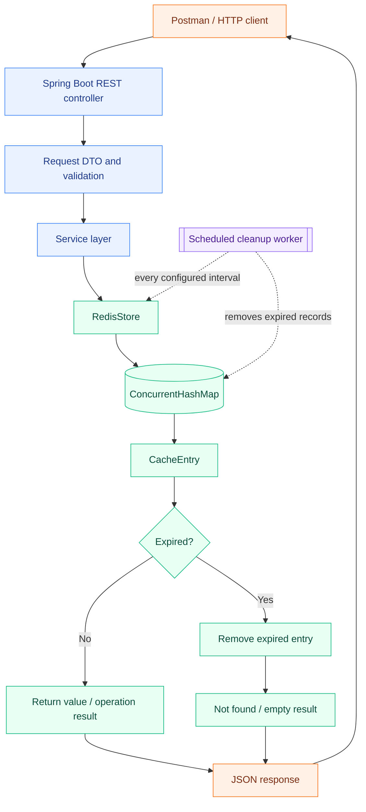

<div align="center">

# RedisLite ⚡

### A lightweight, Redis-inspired in-memory key-value store built with Java and Spring Boot

Store · Read · Expire · Inspect · Delete — through a REST API you can explore in Postman.

[](https://openjdk.org/projects/jdk/21/)
[](https://spring.io/projects/spring-boot)
[](https://maven.apache.org/)
[](#api-reference)
[](postman/RedisLite.postman_collection.json)

**[Run locally](#-run-it-locally) · [Postman walkthrough](#-your-first-postman-workflow) · [API reference](#-api-reference) · [Project structure](#-project-structure)**

</div>

---

## 🔴 The live request workflow

The diagram below is rendered by GitHub from Mermaid when this README is viewed. Follow a request from Postman all the way to the in-memory map and back. The cleanup worker runs separately in the background.



> **What this means:** a controller handles HTTP, a service coordinates the use case, and `RedisStore` owns the actual data. `CacheEntry` keeps the value and its expiration information together. Expired entries are checked when accessed and are also removed by scheduled cleanup.

## ✨ What RedisLite can do

| Capability | What you can try |
|---|---|
| Key-value storage | Create or update a key with `SET` and retrieve it with `GET` |
| Key management | Check with `EXISTS`, remove with `DELETE`, or clear the store |
| Time to live (TTL) | Create an expiring key, inspect its remaining lifetime, or change its expiry |
| Persistence within a process | Remove a key's expiration with `PERSIST` |
| Automatic cleanup | Expired keys are cleaned up on access and by a scheduled task |
| Store visibility | Inspect live entry count, capacity usage, and operation counters |
| Predictable API errors | Receive structured JSON for invalid input, missing keys, and capacity limits |

## 🧰 Technology choices

- **Java 21** for the application and core storage logic.
- **Spring Boot 4.1.2** for REST endpoints, dependency injection, and scheduled cleanup.
- **ConcurrentHashMap** for concurrent access to the in-memory key-value map.
- **ReentrantLock** to coordinate writes that must respect the overall capacity limit.
- **Maven** to build and run the application.
- **Postman** for hands-on API exploration.

This is an educational backend project inspired by Redis concepts. It is not the Redis server, does not implement the Redis wire protocol, and does not connect to a Redis instance.

---

## 🚀 Run it locally

### Before you start

Install:

- Java Development Kit (JDK) **21** or newer.
- Maven **3.6.3** or newer, unless you use IntelliJ IDEA's Maven integration or Docker.
- [Postman](https://www.postman.com/downloads/) to send API requests.

### Option 1 — IntelliJ IDEA

1. Download and extract the project ZIP.
2. Open the `RedisLite` folder in IntelliJ IDEA.
3. When prompted, import or load the project as a Maven project using `pom.xml`.
4. Set the Project SDK to Java 21.
5. Open `src/main/java/com/redislite/RedisLiteApplication.java` and run `RedisLiteApplication`.
6. Wait for the Spring Boot startup message. The API will be available at `http://localhost:8080`.

### Option 2 — Windows

Open PowerShell or Command Prompt in the project folder:

```powershell
.\run.bat
```

Or run Maven directly:

```powershell
mvn spring-boot:run
```

### Option 3 — macOS / Linux

Open a terminal in the project folder:

```bash
chmod +x run.sh
./run.sh
```

Or run Maven directly:

```bash
mvn spring-boot:run
```

### Option 4 — Docker

If Docker Desktop is installed and running:

```bash
docker compose up --build
```

The first run downloads the base image and Maven dependencies. Keep the terminal open while RedisLite is running. Stop it with `Ctrl+C`; you can then run `docker compose down` to remove the stopped containers.

### Check that the API is alive

Send this request from a browser, Postman, or a terminal:

```http
GET http://localhost:8080/api/v1/health
```

Expected response:

```json
{
  "status": "UP",
  "application": "RedisLite"
}
```

If you receive this response, the application has started and is accepting requests.

---

## 🧪 Your first Postman workflow

The project includes a ready-to-import collection with **13 requests**. You do not need to create each request by hand.

### Import the collection

1. Start RedisLite using one of the options above.
2. Open Postman and select **Import**.
3. Select `postman/RedisLite.postman_collection.json` from the extracted project folder.
4. Open the imported **RedisLite API** collection.
5. The collection already has a `baseUrl` variable set to `http://localhost:8080`.
6. Open a request and press **Send**. You can run the requests in order for the guided demo.

### Follow one complete key lifecycle

The example below shows the normal journey of a key: create it, retrieve it, give it an expiry, inspect its TTL, make it permanent again, and delete it.

#### 1. Store a permanent value — SET

`POST http://localhost:8080/api/v1/keys`

Body → raw → JSON:

```json
{
  "key": "user:101",
  "value": "Abhay"
}
```

A newly created key returns `201 Created`. Replacing an existing key returns `200 OK`.

#### 2. Retrieve the value — GET

`GET http://localhost:8080/api/v1/keys/user:101`

Example response:

```json
{
  "key": "user:101",
  "value": "Abhay",
  "createdAt": "2026-10-31T12:00:00Z",
  "expiring": false
}
```

`createdAt` is generated at runtime, so your timestamp will be different.

#### 3. Check whether the key exists — EXISTS

`GET http://localhost:8080/api/v1/keys/user:101/exists`

Example response:

```json
{
  "key": "user:101",
  "exists": true
}
```

#### 4. Inspect its TTL

`GET http://localhost:8080/api/v1/keys/user:101/ttl`

A permanent key reports `expiring: false` and `remainingTtlMillis: null`.

#### 5. Create a key that expires — SET with TTL

`POST http://localhost:8080/api/v1/keys/expiring`

Body → raw → JSON:

```json
{
  "key": "session:demo",
  "value": "active",
  "ttlSeconds": 60
}
```

#### 6. Check the remaining lifetime — TTL

`GET http://localhost:8080/api/v1/keys/session:demo/ttl`

The response includes `remainingTtlMillis`. The number decreases as time passes. If the key expires, a later lookup treats it as missing.

#### 7. Change the expiry — EXPIRE

`POST http://localhost:8080/api/v1/keys/session:demo/expire`

Body → raw → JSON:

```json
{
  "ttlSeconds": 120
}
```

#### 8. Remove the expiry — PERSIST

`POST http://localhost:8080/api/v1/keys/session:demo/persist`

This keeps the value in the store but makes it permanent for the lifetime of the application process.

#### 9. Remove the key — DELETE

`DELETE http://localhost:8080/api/v1/keys/session:demo`

A successful delete returns an operation response. Deleting a key that does not exist returns `404 Not Found`.

#### 10. Inspect store statistics

`GET http://localhost:8080/api/v1/stats`

The response includes the current entry count, configured maximum, capacity percentage, and operation counters.

### Other useful Postman requests

| Request | Method and path | Purpose |
|---|---|---|
| Health check | `GET /api/v1/health` | Confirm the API is running |
| Run cleanup now | `POST /api/v1/admin/cleanup` | Remove expired entries immediately |
| Clear all keys | `DELETE /api/v1/admin/keys` | Empty the in-memory store for a fresh demo |

> ⚠️ `DELETE /api/v1/admin/keys` is destructive: it removes every key currently held by this application instance.

For a printable walkthrough, open [RedisLite_Postman_Guide.pdf](RedisLite_Postman_Guide.pdf).

---

## 📚 API reference

All endpoints use the base path `http://localhost:8080/api/v1`. Requests and responses use JSON unless no body is required.

| Operation | Method | Endpoint | Request body |
|---|---|---|---|
| Health | `GET` | `/health` | — |
| Store or update a permanent value | `POST` | `/keys` | `{"key":"user:101","value":"Abhay"}` |
| Store a value with TTL | `POST` | `/keys/expiring` | `{"key":"session:demo","value":"active","ttlSeconds":60}` |
| Read a value | `GET` | `/keys/{key}` | — |
| Check key existence | `GET` | `/keys/{key}/exists` | — |
| Read remaining TTL | `GET` | `/keys/{key}/ttl` | — |
| Apply or reset TTL | `POST` | `/keys/{key}/expire` | `{"ttlSeconds":120}` |
| Remove TTL | `POST` | `/keys/{key}/persist` | — |
| Delete one key | `DELETE` | `/keys/{key}` | — |
| View metrics | `GET` | `/stats` | — |
| Clean expired entries now | `POST` | `/admin/cleanup` | — |
| Clear all entries | `DELETE` | `/admin/keys` | — |

For keys containing reserved URL characters, URL-encode the key in the path. For an easier first run, use simple keys such as `user:101` or `session:demo`.

### HTTP status and error responses

| Status | Meaning | Typical reason |
|---|---|---|
| `200 OK` | Request completed | Read, update, or successful operation |
| `201 Created` | New key created | First `SET` for a key |
| `400 Bad Request` | Invalid request | Missing field, blank key, invalid TTL, or configured length exceeded |
| `404 Not Found` | Key not available | Key does not exist or has expired |
| `409 Conflict` | Storage limit reached | A new key cannot fit within configured capacity |

Errors use a consistent JSON shape:

```json
{
  "timestamp": "2026-10-31T12:00:00Z",
  "status": 404,
  "error": "Not Found",
  "message": "Key was not found: user:404",
  "path": "/api/v1/keys/user:404"
}
```

The timestamp and message depend on the request you send.

---

## 🏗️ Project structure

```text
RedisLite/
├── src/main/java/com/redislite/
│   ├── RedisLiteApplication.java  # Spring Boot entry point
│   ├── config/                    # Store bean and configuration
│   ├── controller/                # REST API endpoints
│   ├── core/                      # RedisStore, StoreConfig, StoreMetrics
│   ├── dto/                       # Request and response records
│   ├── exception/                 # Consistent JSON error handling
│   ├── model/                     # CacheEntry model
│   └── service/                   # Key-value, expiry, and metrics logic
├── src/main/resources/
│   └── application.properties     # Port, capacity, limits, cleanup interval
├── postman/
│   └── RedisLite.postman_collection.json
├── RedisLite_Postman_Guide.pdf
├── pom.xml
├── Dockerfile
├── compose.yaml
├── run.bat
├── run.sh
└── README.md
```

## ⚙️ Configuration

You can change these values in `src/main/resources/application.properties`:

| Property | Default | Description |
|---|---:|---|
| `server.port` | `8080` | HTTP server port |
| `redislite.store.max-entries` | `100000` | Maximum number of live keys |
| `redislite.store.max-key-length` | `256` | Maximum key length, measured in Java characters |
| `redislite.store.max-value-length` | `1048576` | Maximum value length, measured in Java characters |
| `redislite.store.max-ttl-seconds` | `31536000` | Maximum allowed TTL, one year |
| `redislite.cleanup-interval-ms` | `30000` | Delay between scheduled cleanup runs, in milliseconds |

Restart the application after changing configuration values.

---

## 🧠 Engineering notes

A few choices are worth understanding before you discuss this project in an interview:

- **ConcurrentHashMap:** supports concurrent access to the key-value map without synchronizing every read on the whole map.
- **ReentrantLock:** coordinates write operations that must respect the overall maximum-entry limit.
- **CacheEntry:** keeps the value, creation timestamp, and optional expiration deadline together.
- **System.nanoTime():** measures elapsed time for TTL checks without depending on wall-clock changes.
- **Lazy expiration:** an expired entry is treated as missing and removed when accessed.
- **Scheduled cleanup:** a background task periodically removes expired entries even when they are not requested again.
- **LongAdder metrics:** tracks operation counters with low contention for the statistics endpoint.
- **Layered design:** controllers handle HTTP, services coordinate use cases, and the core package owns storage behavior.

### A simple interview explanation

> I built RedisLite to understand how an in-memory key-value store works behind an API. I used Java and Spring Boot to expose operations such as SET, GET, DELETE, EXISTS, and TTL. The storage layer uses ConcurrentHashMap, while a small lock coordinates writes that must respect the configured capacity. I also added expiration handling, scheduled cleanup, operation metrics, and structured API errors. I use Postman to demonstrate the complete key lifecycle.

Be ready to explain the trade-offs too: this is a single-process demonstration, not a distributed cache or a production replacement for Redis.

## ⚠️ Scope and limitations

- Data lives in application memory and is lost when the process stops or restarts.
- The store belongs to one application instance; it is not shared across multiple instances.
- The project does not implement persistence, replication, clustering, authentication, or the Redis wire protocol.
- The current API is intended for local learning and demonstration. Do not expose it publicly without adding appropriate security and operational protections.
- There is intentionally no `src/test` folder in this delivery. Use the included Postman collection for manual verification.

## 📦 Project files

- [Postman collection](postman/RedisLite.postman_collection.json) — import and run the ready-made requests.
- [Postman PDF guide](RedisLite_Postman_Guide.pdf) — printable setup and API walkthrough.
- [Maven build file](pom.xml) — project dependencies and Java version.

---

<div align="center">

**RedisLite — a practical way to explore the building blocks of an in-memory store.**

Built with Java ☕ · Spring Boot 🍃 · Postman 🟠

</div>
